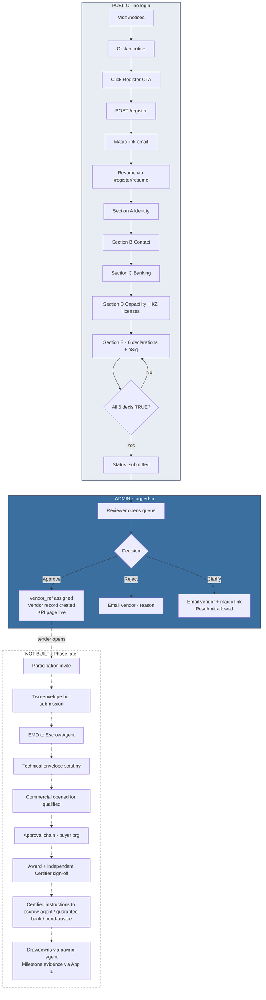

# PMC v2 · Current-State Answers to Client Questions

**Prepared for:** Client review · February 2026
**Scope:** Direct answers to three questions about the deployed v2 pilot, with concrete file references.

---

## Question A — Where is the payment gateway integrated currently?

### Short answer

**Nowhere. There is zero payment-gateway code in the running v2 platform.**

### The evidence

| Layer | What we grep'd | Result |
|---|---|---|
| Backend Python | `grep -rn "stripe\|payment" /app/backend/*.py /app/backend/routers/*.py` | **0 matches** |
| Backend imports | `import stripe` / `from stripe import` | **0 occurrences** |
| Frontend React | `grep -rn "stripe\|payment" /app/frontend/src/` | **0 matches** |
| Frontend components | Stripe.js / PaymentElement / any checkout UI | **0** |
| Requirements file | `backend/requirements.txt` | Line 111: `stripe==14.4.1` — **dep is installed but never imported** (leftover from v1) |

### Why it's not there

Per **PMC Build Sheet v2 · Part 5** (verbatim):
> *"Never implement — encryption, key management, bid submission, bid opening, evaluation scoring, contract award, **payment processing**."*

And per **Transaction Structure Report · §7**:
> *"PMC must not hold client funds. Bid security (EMD), performance guarantees, retention and drawdowns sit with a **regulated escrow agent, guarantee bank, bond trustee**, not with PMC's operating accounts."*

So the correct answer is not just "we haven't done it yet" — it's **"we were told not to build it, because PMC is not the party that should hold the money."**

### What we DO have in place (structurally)

| Item | State | Note |
|---|---|---|
| Vendor **registration fee** flow | 🟡 Endpoint contract designed but disabled | `decl_fee` checkbox in Section E asks vendors to acknowledge fee non-refundable; no fee actually charged |
| EMD / bid security flow | ⚪ Not built | Awaits escrow-agent appointment (Transaction Structure §9 Q4) |
| Performance guarantee / retention | ⚪ Not built | Awaits guarantee-bank appointment |
| Construction drawdown | ⚪ Not built | Awaits bond-trustee appointment |
| Legacy Stripe integration | Archived in `pmc-tender-v1-legacy` (tag v1.0) | Available for reference only; not running |

### What activating payments would require (once counsel & appointments are done)

1. Choose the regulated holder (escrow / guarantee bank / trustee) — **client + counsel decision**
2. Emergent adds a certified-instruction workflow (already designed in the Transaction Structure Report §7) as a new backend module
3. Add a limited-scope **`/api/v1/instructions`** endpoint that transmits release/return instructions to the holder — never touches the actual money
4. Reconciliation dashboard for admin
5. Related-party register + float-interest disclosure UI

**None of this is "add Stripe." It is "instruct a bank on behalf of another party."** That is Doc 1's whole point.

---

## Question B — Do we have separate logins for the 10 external roles from the Transaction Structure Report?

### Short answer

**No. Not one of them.**

The v2 pilot has exactly **two roles**: `admin` and `reviewer`. That's it.

### The evidence

`/app/backend/models/admin_user.py`:
```python
AdminRole = Literal["admin", "reviewer"]
```

`/app/backend/security.py`:
```python
def require_role(*roles: str):
    async def _dep(admin, _csrf):
        if admin.get("role") not in roles:
            raise HTTPException(status_code=403, detail="Insufficient permissions")
        return admin
    return _dep
```

### Role-by-role gap

| Role | Function per Transaction Structure Report | Login today? | What's needed |
|---|---|---|---|
| **PMC Admin** | Manage registrations, publish notices, run the platform | ✅ Yes (`admin`) | — |
| **PMC Reviewer** | Second pair of eyes on vendor decisions | ✅ Yes (`reviewer`) | — |
| **Vendor / Supplier** | Self-registers, will bid in future | 🟡 Self-service registration only (magic-link, no persistent login) | Add supplier portal login post-approval |
| **Escrow Agent** | Holds EMD; releases on certified instruction | ❌ **No login, no role, no read-only view** | New role + read-only escrow dashboard |
| **Guarantee Bank** | Holds performance bond + retention | ❌ **No login** | New role + read-only bond dashboard |
| **Bond Trustee** | Custodian for construction drawdowns | ❌ **No login** | New role + drawdown-approvals view |
| **Security Agent** | Coordinates enforcement across bond-holders | ❌ **No login** | New role + cross-holder read view |
| **Paying Agent** | Executes drawdown instructions | ❌ **No login** | New role + instruction inbox |
| **Independent Certifier / Engineer** | Signs off milestones (this is where App 1 evidence flows) | ❌ **No login, no App 1 either** | Depends on App 1 mobile (Phase 2) |
| **Legal Counsel** | Reviews contract clauses, watches audit chain | ❌ **No login** | Read-only audit + document repo |
| **Account Bank** | Runs PMC's own operating accounts | ❌ **No login** | Reconciliation-only view |
| **KYC / Screening Provider** | Runs sanctions / PEP checks on vendors | ❌ **No login, no API integration** | Provider-specific API + webhook + result-store table |

### Why the gap exists (and it's the right call for now)

The Build Sheet Part 5 excludes the actual **money-touching** activities. Since none of the 10 external actors have any *action* to take on the platform today (no bids are being opened, no bonds are being called, no money is moving), building them logins would be building empty rooms.

**But — as soon as the 6 legal questions in Transaction Structure §9 are answered and appointments are signed, all 10 logins become the highest-priority Phase-2 work.** Each one needs:
- Row in `admin_users` with a new role literal (`escrow_agent`, `bond_trustee`, etc.)
- New router with role-gated endpoints
- Dedicated dashboard tab in the admin console (or standalone sub-app)
- Signed instruction ingress (webhook or SFTP) if the holder wants to push data back

We already have the technical scaffolding to add these — `require_role(...)` is designed to accept any string, and the audit-log system is ready to record cross-actor state changes.

---

## Question C — Flow diagram: registration → participation → bid → scrutiny → verification → award

### ⚠️ Important — read this first

Per Build Sheet Part 5 the following stages are **explicitly out of scope of v2**:

- Bid participation
- Bid scrutiny / opening
- Bid verification / evaluation scoring
- Contract award

They will be added in a **later phase** (not Phase 2 either — Phase 2 is only AWS migration + App 1 mobile evidence + escrow-agent integration).

So the flow diagram below has **two layers**:

- **SOLID lines** = **implemented and running today** in v2
- **DOTTED lines** = **not built today**; shown as intended when bidding is activated (with the correct escrow-agent-in-the-loop model from Transaction Structure Report)

---

### Diagram · what runs today AND what's designed for later

```
┌──────────────────────────────────────────────────────────────────────────────┐
│                            PUBLIC (no login)                                 │
├──────────────────────────────────────────────────────────────────────────────┤
│                                                                              │
│  [1] Vendor lands on /notices     ─────►  browses open tender notices        │
│         │                                     │                              │
│         │                                     ▼                              │
│         │                          [2] Clicks a specific notice              │
│         │                                     │                              │
│         │                                     ▼                              │
│         │             [3] "Register as supplier" CTA (public notice detail)  │
│         ▼                                     │                              │
│  ┌──────────────────────────────────────────┐│                               │
│  │  REGISTRATION FLOW (public + magic-link) │◄┘                              │
│  ├──────────────────────────────────────────┤                                │
│  │                                          │                                │
│  │  [4] POST /register email + country      │  (creates draft)               │
│  │         │                                │                                │
│  │         ▼                                │                                │
│  │  [5] Emergent sends magic-link email     │  fire-and-forget               │
│  │         │  ▲                             │                                │
│  │         ▼  │ (7-day nudge if abandoned)  │                                │
│  │  [6] Vendor opens /register/resume?token │                                │
│  │         │                                │                                │
│  │         ▼                                │                                │
│  │  [7] Section A · Identity                │                                │
│  │  [8] Section B · Contact & signatory     │                                │
│  │  [9] Section C · Banking & 3-yr turnover │                                │
│  │  [10] Section D · Capability + categories │                                │
│  │        · KZ licenses held (6-checkbox)   │                                │
│  │  [11] Section E · 6 declarations + eSig  │                                │
│  │         │                                │                                │
│  │         ▼                                │                                │
│  │  [12] POST /submit — declarations gate   │                                │
│  │         │  ALL 6 must be TRUE            │                                │
│  │         │  else 400 with missing list    │                                │
│  │         ▼                                │                                │
│  │  [13] status = "submitted"               │                                │
│  │                                          │                                │
│  └──────────────────────────────────────────┘                                │
│                        │                                                     │
│                        ▼                                                     │
├──────────────────────────────────────────────────────────────────────────────┤
│                     ADMIN (login required)                                   │
├──────────────────────────────────────────────────────────────────────────────┤
│                        │                                                     │
│                        ▼                                                     │
│  [14] Reviewer opens Registrations tab                                       │
│         │                                                                    │
│         ▼                                                                    │
│  [15] Reviewer picks a submission                                            │
│         │                                                                    │
│         ├─►  APPROVE     ────►  [16a] vendor_ref PMC-SUP-000001 assigned      │
│         │                              │                                     │
│         │                              ▼                                     │
│         │                    [17a] Vendor record created + email sent        │
│         │                              │                                     │
│         │                              ▼                                     │
│         │                    [18a] Vendor now appears on Vendors tab         │
│         │                              (KPI dashboard: licenses,             │
│         │                               categories, review turnaround)       │
│         │                                                                    │
│         ├─►  REJECT (notes required)                                         │
│         │        └─►  [16b] Vendor emailed; status = "rejected"              │
│         │                                                                    │
│         └─►  CLARIFY (notes required)                                        │
│                  └─►  [16c] Vendor emailed with same magic link              │
│                              status = "needs_clarification"                  │
│                              Vendor can edit + resubmit                      │
│                                                                              │
│                                                                              │
│  ============ EVERYTHING ABOVE IS LIVE TODAY ✅ ============                  │
│                                                                              │
│  ============ EVERYTHING BELOW IS NOT BUILT ⚠️  ============                  │
│                                                                              │
│                        │                                                     │
│                        ▼ (once Phase 2 legal appointments are done)          │
│                                                                              │
│  [19] ⋯ Approved vendor gets participation invite for a notice ⋯             │
│         │                                                                    │
│         ▼                                                                    │
│  [20] ⋯ Vendor logs into supplier portal (not built) ⋯                       │
│         │                                                                    │
│         ▼                                                                    │
│  [21] ⋯ Vendor submits two-envelope bid ⋯                                     │
│         │  ┌─── technical envelope (sealed until pre-bid deadline)           │
│         │  └─── commercial envelope (sealed until technical qualified)       │
│         │                                                                    │
│         ▼                                                                    │
│  [22] ⋯ Vendor posts EMD to ESCROW AGENT ⋯   (money never touches PMC)        │
│         │                                                                    │
│         ▼                                                                    │
│  [23] ⋯ PMC admin closes bid at deadline ⋯                                    │
│         │                                                                    │
│         ▼                                                                    │
│  [24] ⋯ Technical envelope opened; two-reviewer scrutiny ⋯                    │
│         │  ┌─── auto-qualification: KZ licenses match required_licenses       │
│         │  └─── manual: completeness of technical proposal                    │
│         │                                                                    │
│         ▼                                                                    │
│  [25] ⋯ Commercial envelope opened only for technically-qualified bidders ⋯   │
│         │                                                                    │
│         ▼                                                                    │
│  [26] ⋯ Multi-level approval chain (buyer org · budget threshold) ⋯           │
│         │                                                                    │
│         ▼                                                                    │
│  [27] ⋯ Award decision → Independent Certifier signs off ⋯                    │
│         │                                                                    │
│         ▼                                                                    │
│  [28] ⋯ PMC issues certified instructions to escrow-agent:                   │
│         │       · release EMD to winning bidder                              │
│         │       · forfeit / refund EMD to losers                             │
│         │       · request performance-guarantee posting from winner         │
│         │  Money moves BETWEEN escrow-agent and guarantee-bank,              │
│         │  NEVER through PMC. ⋯                                              │
│         ▼                                                                    │
│  [29] ⋯ Contract executed; drawdown schedule handed to bond-trustee ⋯         │
│         │                                                                    │
│         ▼                                                                    │
│  [30] ⋯ App 1 (mobile evidence) captures milestone events with GPS +          │
│         WORM storage in S3 Object Lock ⋯                                     │
│         │                                                                    │
│         ▼                                                                    │
│  [31] ⋯ Independent Certifier reviews evidence → signs milestone ⋯            │
│         │                                                                    │
│         ▼                                                                    │
│  [32] ⋯ PMC instructs paying-agent to release drawdown from bond ⋯            │
│                                                                              │
└──────────────────────────────────────────────────────────────────────────────┘
```

### Same flow expressed as Mermaid (renders at https://mermaid.live)



---

## Summary in three sentences

1. **Payments today = zero code, by design.** Build Sheet Part 5 excludes payment processing, and Transaction Structure Report §7 says PMC must not hold money anyway.
2. **External-actor logins today = zero.** Ten role-based logins (escrow agent, bond bank, trustee, security agent, paying agent, certifier, counsel, KYC provider, account bank, supplier post-approval) all need to be added — the scaffolding exists (`require_role`, JWT, audit log), but no role literals or dashboards are wired.
3. **Live flow today = registration → admin decision → approved vendor with KPI.** Everything from bid submission onward is out of scope in v2 and needs to be enabled in a Phase after Phase 2, once counsel + regulated appointments (Transaction Structure §9) are done.

---

## What I'd recommend telling your client at the next meeting

> "We built exactly what the AWS Build Sheet said to build in Phase 1. What you're seeing is the vendor onboarding funnel and admin controls, running on a portable stack. The bidding, award, escrow and evidence flows are all designed but deliberately paused until (a) counsel answers the six legal questions in the Transaction Structure Report, and (b) the escrow agent, guarantee bank and bond trustee are formally appointed. When those two things happen, we activate the greyed-out portion of the flow — with the appointed institutions holding the money, and PMC only issuing certified instructions. The platform never touches funds."

*Document generated from live source code. Regenerable on request.*
