# PMC Managers · v46 Master Training Manual

_PMC Managers Limited — Confidential — v46 — Sep 2026_

This manual is the authoritative operator handbook for the PMC Managers Global Tender Board, version 46 (September 2026). It walks every role through every screen with annotated screenshots, field-by-field guidance, and known-gotcha callouts. Use it as your first-day onboarding pack.

## Table of contents

1. Platform overview & architecture
2. Roles at a glance
3. Public visitor journey
4. Vendor / supplier journey
5. Admin console — full 23-tab tour
6. Deep-dive: Tender Builder & AI DPR (v46g)
7. Tooltip + error-handling system (InfoDot, toasts, ErrorBoundary)
8. Troubleshooting playbook
9. Glossary & API reference index

## 1 · Platform overview & architecture

The PMC platform is a multi-role tender lifecycle engine covering the full path from notice publication → registration → bidding → EMD → evaluation → award → e-signature → invoicing → post-contract audit. It is delivered as a React single-page app backed by a FastAPI service and MongoDB, with same-origin cookie-based sessions and CSRF double-submit tokens.

- **Frontend** — React SPA served from S3 + CloudFront.
- **Backend** — FastAPI on AWS Elastic Beanstalk (Docker).
- **Auth** — HttpOnly session cookie + `X-CSRF-Token` header on writes.
- **AI** — LLM proxy for DPR ingestion, section drafting, audit copilot.
- **Storage** — MongoDB collections for tenants, notices, tenders, EMD, bids, awards, audits, ratings, auctions, engagements.

## 2 · Roles at a glance

| Role | Portal | Scope |
|---|---|---|
| Admin | `/admin` | Full control of every module. |
| Reviewer | `/admin` | Read-only + evaluation scoring. |
| Escrow agent | `/staff` | EMD desk, forfeitures, refunds. |
| Certifier | `/staff` | Tender packet sign-off. |
| Legal counsel | `/staff` | Contract review, DocuSign envelope owner. |
| Accounting | `/staff` | Fee invoicing, refunds, reconciliation. |
| Committee member | `/staff` | Evaluation committee voting. |
| Auditor | `/admin` (read) | Full audit trail with entity filters. |
| Support | `/staff` | Vendor helpdesk, activation resends. |
| Vendor | `/vendor` | Bid on notices, manage profile & invoices. |

## 3 · Public visitor journey

###  1 · Landing page — Kazakhstan programme hero

Public homepage. Shows live counters (Notices Published, Suppliers Approved, Work Packages) and quick paths to browse open tenders or register as a supplier.

*Landing page — Kazakhstan programme hero*

#### Purpose

Front door for every visitor. Establishes brand, states the current programme scope (Kazakhstan Integrated Development), and surfaces three live KPIs pulled from the API in real time.

#### Fields

- **NOTICES PUBLISHED** — Count of notices with is_published=True.

- **SUPPLIERS APPROVED** — Total registered vendor accounts.

- **WORK PACKAGES** — Modular deliverable packets configured for the programme.

- **VIEW OPEN NOTICES** — Deep-links to the public tender board.

- **REGISTER AS A SUPPLIER** — Kicks off the supplier onboarding flow.

#### Known gotchas

- Counters are live; if they show 0 after a deploy, hard-refresh the browser — CloudFront may still be serving a stale bundle.

###  2 · Notice board — all published tenders

Filterable list of every published notice: country, category, budget currency, submission deadline, EMD terms, contact.

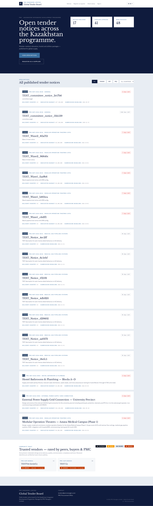

*Notice board — all published tenders*

#### Purpose

The public tender board — the primary discovery surface for any prospective bidder. Every notice with `is_published=True` appears here in reverse chronology.

#### Fields

- **Search bar** — Fuzzy-match on title, description, country and category.

- **Country / category filters** — Server-side filters piped through the notices API.

- **Row card** — Shows submission deadline, budget currency+amount, EMD hint, licence tags. Click to open the detail page.

#### Known gotchas

- Deadlines are shown in the browser's local timezone.

###  3 · Notice detail — full tender packet

Selecting any notice opens the public detail view with full description, documents, EMD/tender-fee summary, corrigenda log, Q&A, and download-tender-packet button.

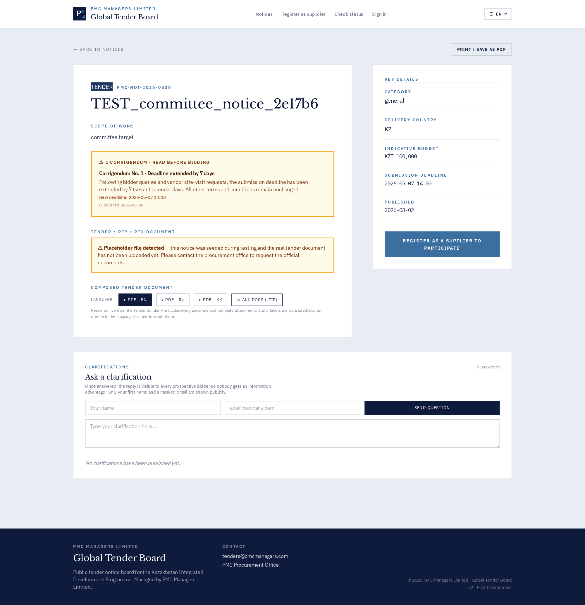

*Notice detail — full tender packet*

#### Purpose

Complete tender packet visible to any visitor before login. Every regulatory disclosure lives here.

#### Fields

- **Header block** — Title, reference number, publish/submission dates, EMD.

- **Primary document / attachments** — Signed PDF + supporting files.

- **Corrigenda log** — Every addendum with author + timestamp.

- **Q&A** — Public questions once the admin marks an answer visible.

- **Bid actions** — Visible only once the visitor signs in as a verified vendor.

#### Known gotchas

- The 'Download tender packet' button assembles a ZIP with the composed PDF + every section attachment on the fly.

###  4 · Supplier registration

Public 'Register as supplier' onboarding — email/password, company details, country, licences, consent to data processing. Verification email dispatched on submit.

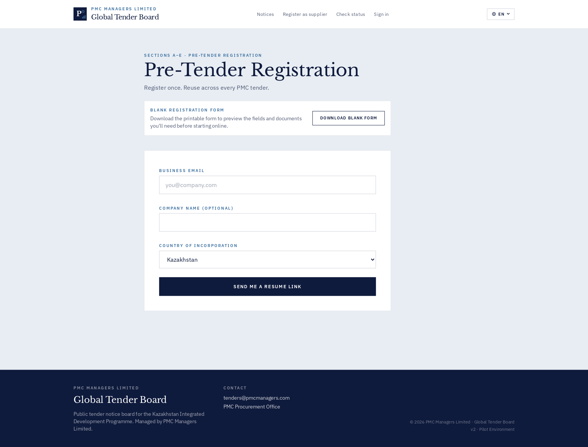

*Supplier registration*

#### Purpose

Supplier self-onboarding. Creates the vendor account, then dispatches a verification email that unlocks the vendor portal.

#### Fields

- **Company details** — Legal name, country, address, VAT/UBO if applicable.

- **Licences** — Country-specific dropdown (Kazakhstan uses SK-* licence codes).

- **Consent switches** — GDPR data-processing + optional marketing opt-in.

#### Known gotchas

- Emails from Resend can hit spam on first-touch corporate mailboxes; admins can resend from the Registrations queue.

###  5 · Unified sign-in — Choose your portal

Employees on the left (any staff role), suppliers on the right. Role selector routes admins to /admin and staff to /staff automatically.

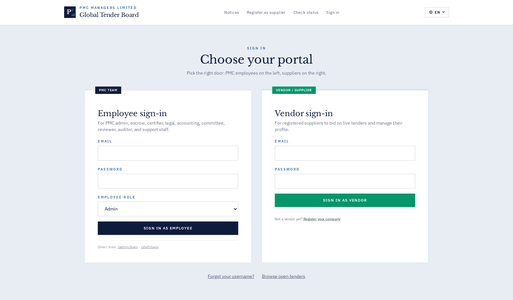

*Unified sign-in — Choose your portal*

#### Purpose

Unified 'Choose your portal' entry. Left card = employees (admin, escrow, certifier, legal, accounting, committee, reviewer, auditor, support). Right card = suppliers.

#### Fields

- **EMPLOYEE ROLE dropdown** — Determines which staff endpoint the client hits.

- **Direct links** — /admin/login and /staff/login bypass the picker.

#### Known gotchas

- MFA/OTP is enforced for admin accounts once configured — the password step will be followed by a code prompt.

## 4 · Vendor / supplier journey

### 60 · Vendor sign-in

Dedicated vendor login (also accessible via /login → right card).

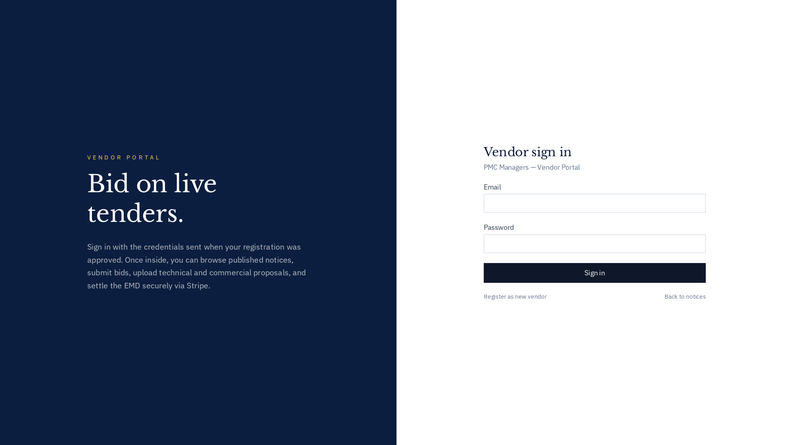

*Vendor sign-in*

#### How to use

This screen exposes every action available for its module. Use the InfoDot (ⓘ) next to each label to see the field-level rules — hover it in-app for the full policy text. All destructive actions confirm before applying and every mutation is written to the immutable audit log.

### 61 · Vendor dashboard landing

Overview of open tenders the vendor may bid on, invoice status, ratings tab, profile & licenses.

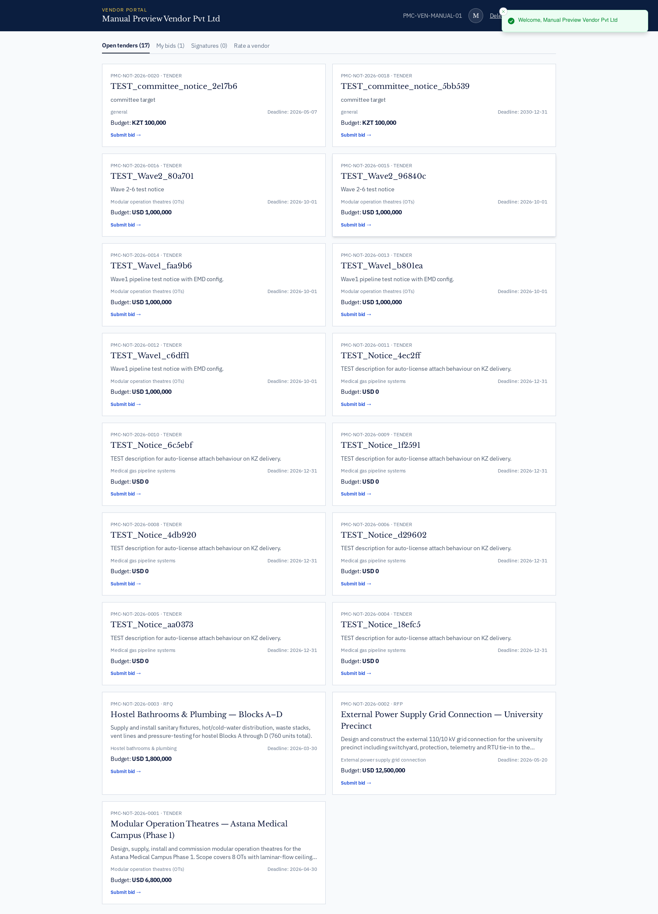

*Vendor dashboard landing*

#### How to use

This screen exposes every action available for its module. Use the InfoDot (ⓘ) next to each label to see the field-level rules — hover it in-app for the full policy text. All destructive actions confirm before applying and every mutation is written to the immutable audit log.

## 5 · Admin console — full 23-tab tour

### 10 · Admin console landing (Operations Overview)

First screen after admin login — tab strip, environment chip, alerts, AI Copilot shortcut, security/2FA badge.

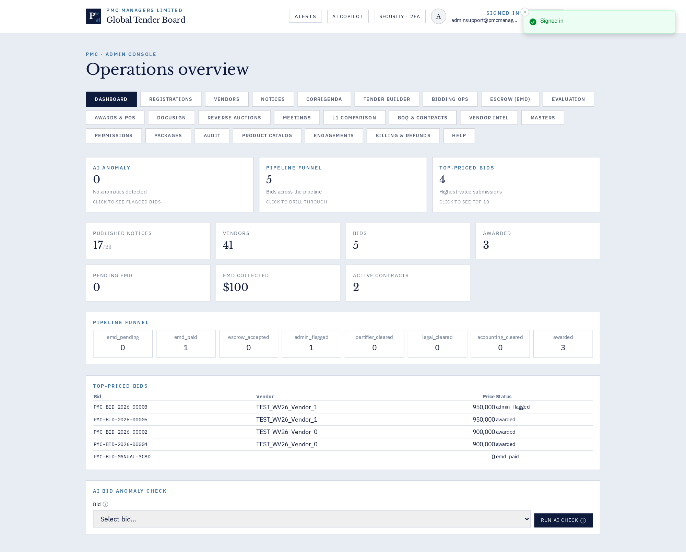

*Admin console landing (Operations Overview)*

#### Purpose

Command centre for PMC staff. The header shows environment tenant, MFA + profile shortcuts, alerts, AI Copilot.

#### Fields

- **Tab strip** — 23 top-level tabs — see per-tab pages below.

- **Environment chip** — Which tenant/programme is currently active.

- **AI Copilot** — In-context question box for procurement policy.

#### Known gotchas

- Some tabs require role escalation (e.g. Escrow needs escrow_agent).

### 11 · Admin · Dashboard analytics

KPIs, funnel drills, revenue by module, activity heatmap.

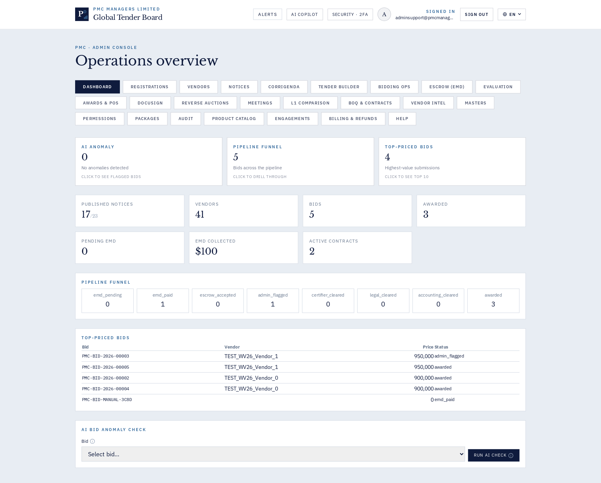

*Admin · Dashboard analytics*

#### How to use

This screen exposes every action available for its module. Use the InfoDot (ⓘ) next to each label to see the field-level rules — hover it in-app for the full policy text. All destructive actions confirm before applying and every mutation is written to the immutable audit log.

### 12 · Admin · Vendor registrations queue

Approve, reject, resend activation, force-activate.

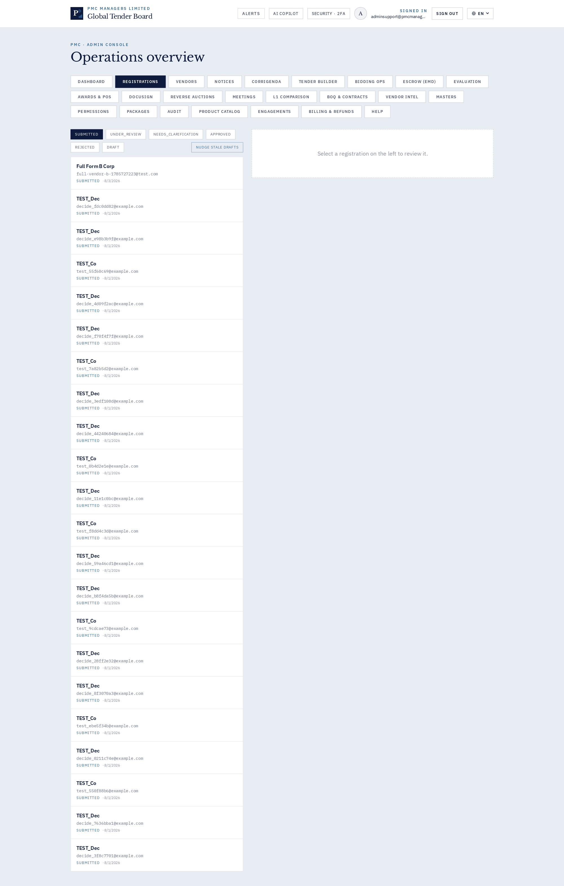

*Admin · Vendor registrations queue*

#### How to use

This screen exposes every action available for its module. Use the InfoDot (ⓘ) next to each label to see the field-level rules — hover it in-app for the full policy text. All destructive actions confirm before applying and every mutation is written to the immutable audit log.

### 13 · Admin · Vendor directory

Full CRUD on suppliers, licenses, compliance, tenants.

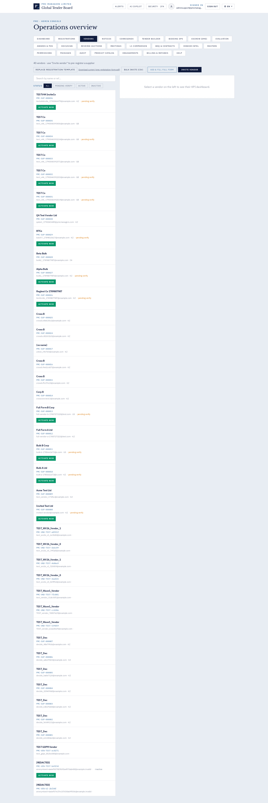

*Admin · Vendor directory*

#### How to use

This screen exposes every action available for its module. Use the InfoDot (ⓘ) next to each label to see the field-level rules — hover it in-app for the full policy text. All destructive actions confirm before applying and every mutation is written to the immutable audit log.

### 14 · Admin · Notices — publish & manage

Create, publish, edit, withdraw, attach documents, EMD.

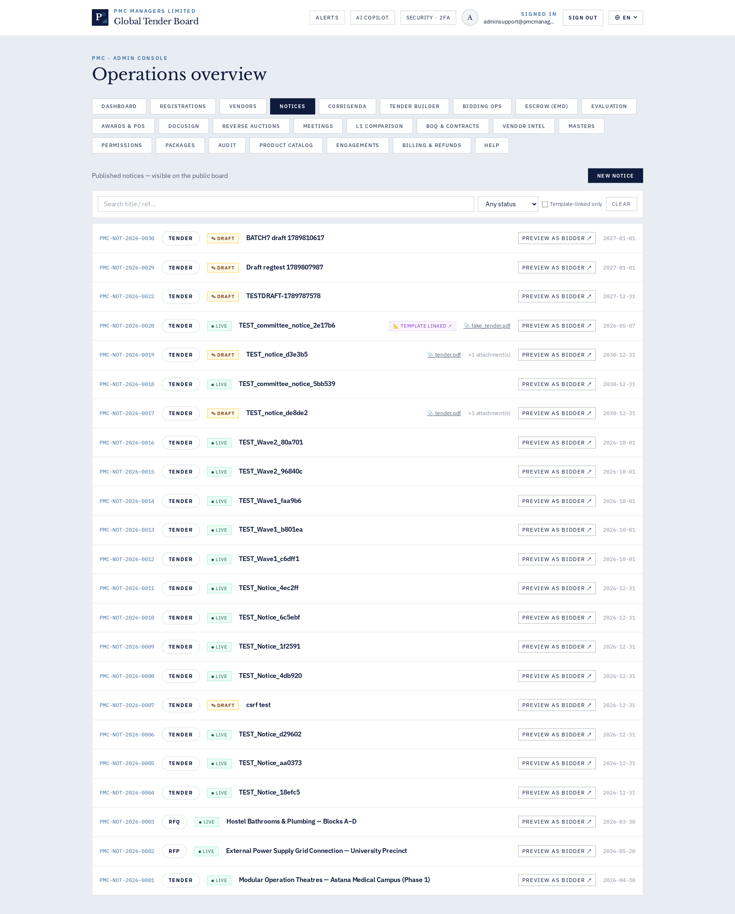

*Admin · Notices — publish & manage*

#### How to use

This screen exposes every action available for its module. Use the InfoDot (ⓘ) next to each label to see the field-level rules — hover it in-app for the full policy text. All destructive actions confirm before applying and every mutation is written to the immutable audit log.

### 15 · Admin · Corrigenda log

Publish addenda/amendments against any live notice.

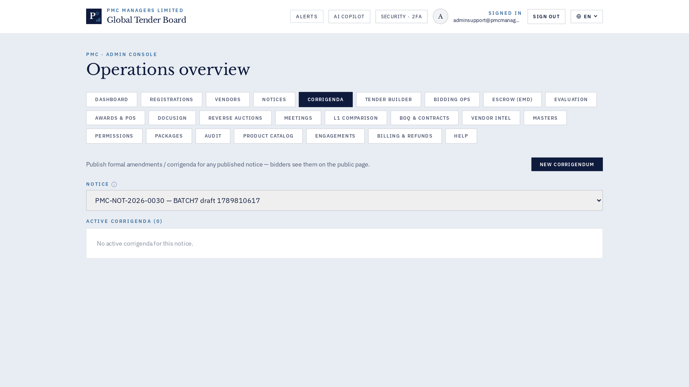

*Admin · Corrigenda log*

#### How to use

This screen exposes every action available for its module. Use the InfoDot (ⓘ) next to each label to see the field-level rules — hover it in-app for the full policy text. All destructive actions confirm before applying and every mutation is written to the immutable audit log.

### 16 · Admin · Tender Builder & DPR AI

Master library, DPR deep-dive, AI Fill All, PDF export.

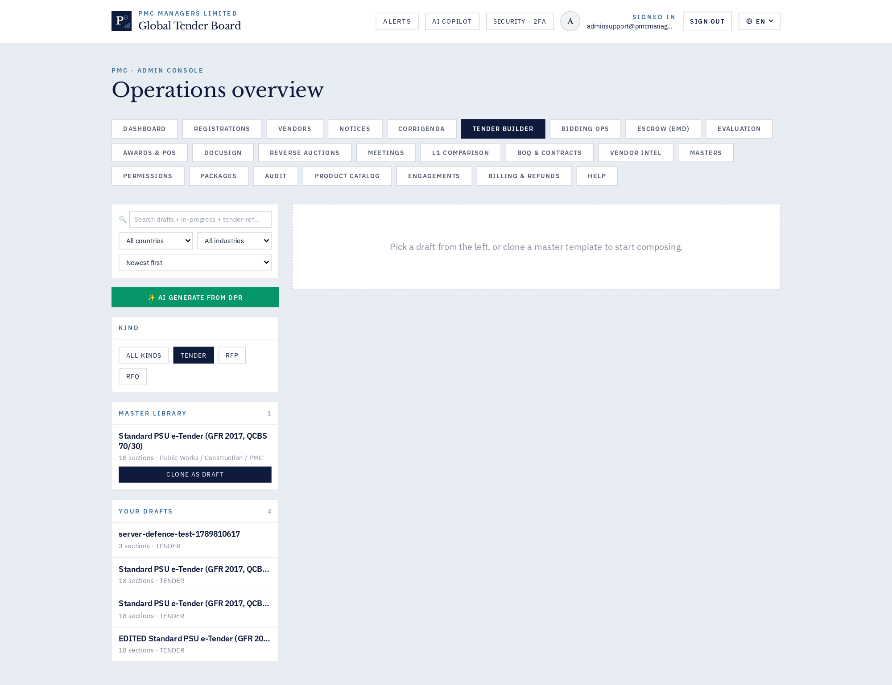

*Admin · Tender Builder & DPR AI*

#### How to use

This screen exposes every action available for its module. Use the InfoDot (ⓘ) next to each label to see the field-level rules — hover it in-app for the full policy text. All destructive actions confirm before applying and every mutation is written to the immutable audit log.

### 17 · Admin · Bidding operations

Bid room, submissions, seal/unseal, timing.

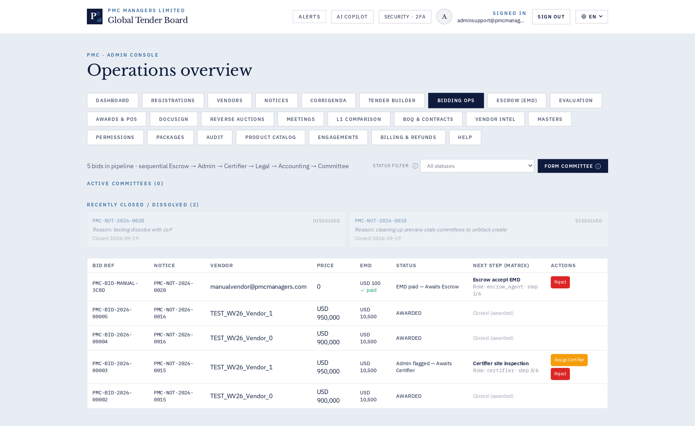

*Admin · Bidding operations*

#### How to use

This screen exposes every action available for its module. Use the InfoDot (ⓘ) next to each label to see the field-level rules — hover it in-app for the full policy text. All destructive actions confirm before applying and every mutation is written to the immutable audit log.

### 18 · Admin · Escrow / EMD desk

EMD receipts, forfeitures, refunds.

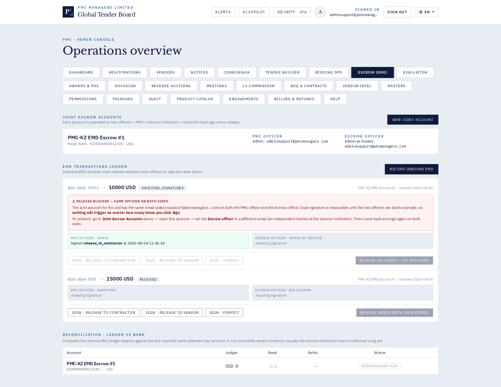

*Admin · Escrow / EMD desk*

#### How to use

This screen exposes every action available for its module. Use the InfoDot (ⓘ) next to each label to see the field-level rules — hover it in-app for the full policy text. All destructive actions confirm before applying and every mutation is written to the immutable audit log.

### 19 · Admin · Evaluation & scoring

Technical + financial scoring, QCBS, L1 comparison.

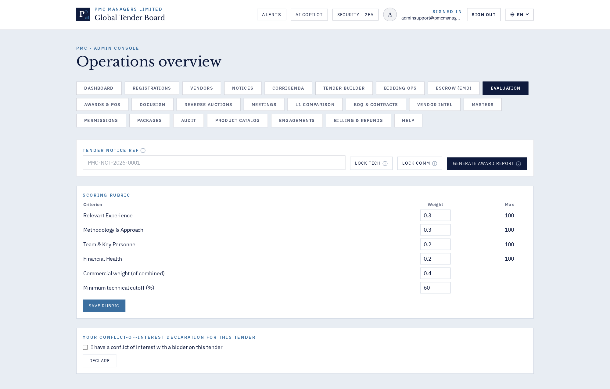

*Admin · Evaluation & scoring*

#### How to use

This screen exposes every action available for its module. Use the InfoDot (ⓘ) next to each label to see the field-level rules — hover it in-app for the full policy text. All destructive actions confirm before applying and every mutation is written to the immutable audit log.

### 20 · Admin · Awards & POs

Letters of award, POs, contract award workflow.

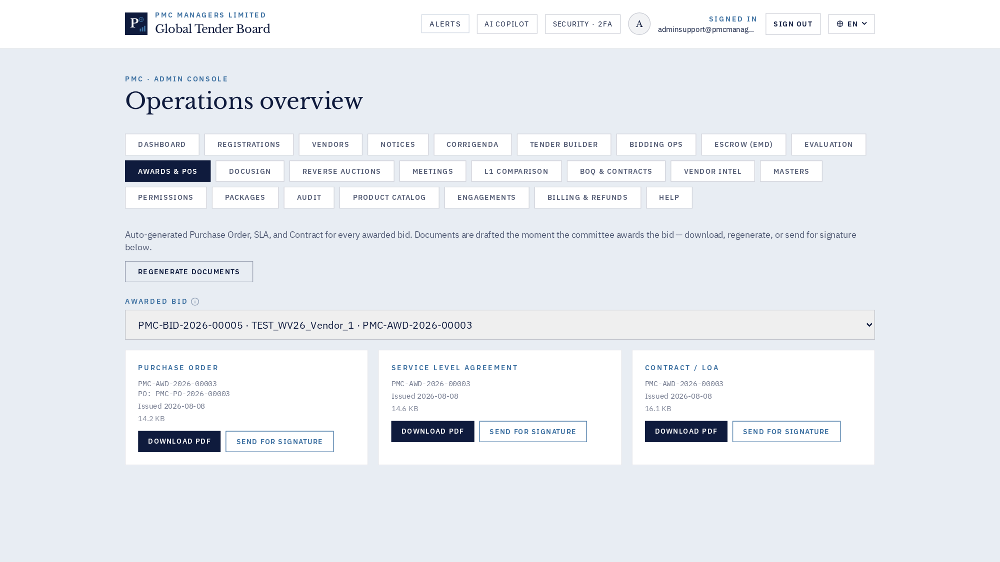

*Admin · Awards & POs*

#### How to use

This screen exposes every action available for its module. Use the InfoDot (ⓘ) next to each label to see the field-level rules — hover it in-app for the full policy text. All destructive actions confirm before applying and every mutation is written to the immutable audit log.

### 21 · Admin · DocuSign contracts

Envelope templates, signer routing, live status.

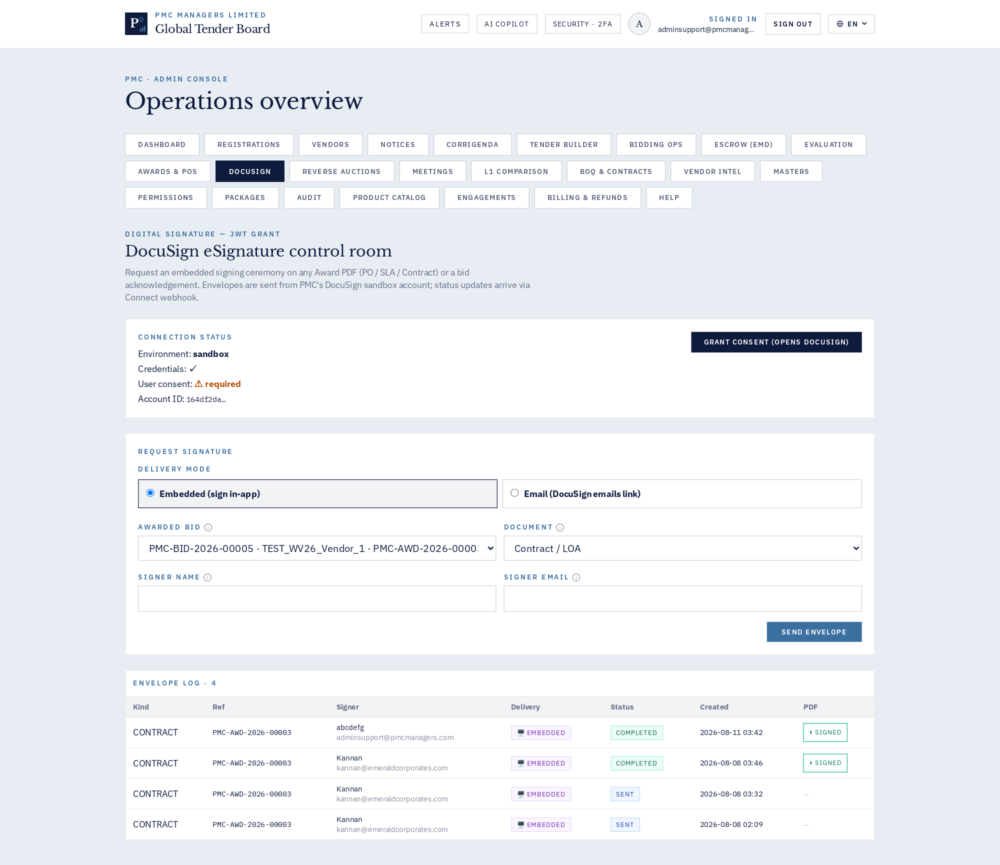

*Admin · DocuSign contracts*

#### How to use

This screen exposes every action available for its module. Use the InfoDot (ⓘ) next to each label to see the field-level rules — hover it in-app for the full policy text. All destructive actions confirm before applying and every mutation is written to the immutable audit log.

### 22 · Admin · Reverse auctions

Live auction rooms, invitations, spectator link.

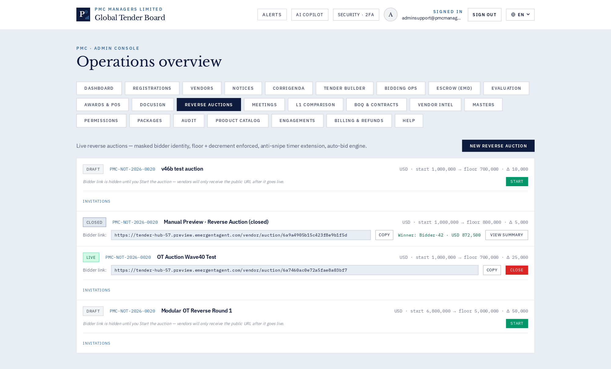

*Admin · Reverse auctions*

#### How to use

This screen exposes every action available for its module. Use the InfoDot (ⓘ) next to each label to see the field-level rules — hover it in-app for the full policy text. All destructive actions confirm before applying and every mutation is written to the immutable audit log.

### 23 · Admin · Pre-bid meetings

Scheduling, Zoom links, minutes, attendance.

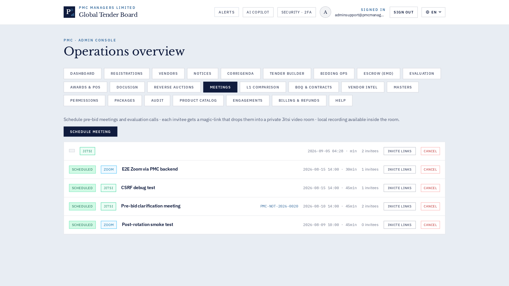

*Admin · Pre-bid meetings*

#### How to use

This screen exposes every action available for its module. Use the InfoDot (ⓘ) next to each label to see the field-level rules — hover it in-app for the full policy text. All destructive actions confirm before applying and every mutation is written to the immutable audit log.

### 24 · Admin · BOQ templates & contracts

Bill of Quantities master + contract line items.

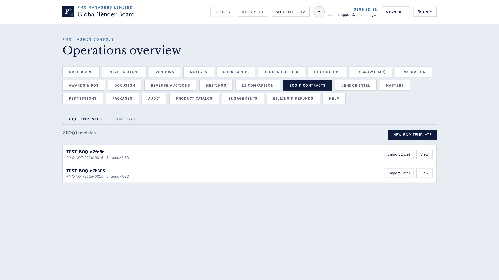

*Admin · BOQ templates & contracts*

#### How to use

This screen exposes every action available for its module. Use the InfoDot (ⓘ) next to each label to see the field-level rules — hover it in-app for the full policy text. All destructive actions confirm before applying and every mutation is written to the immutable audit log.

### 25 · Admin · Vendor intel & ratings

Trust badges, moderation, criteria averages.

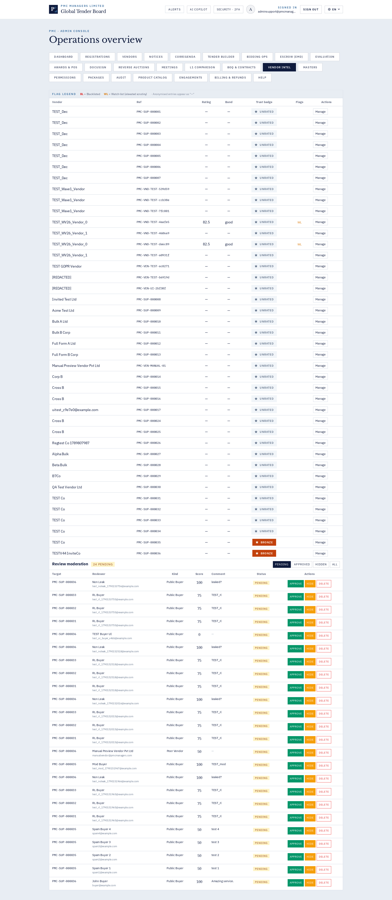

*Admin · Vendor intel & ratings*

#### How to use

This screen exposes every action available for its module. Use the InfoDot (ⓘ) next to each label to see the field-level rules — hover it in-app for the full policy text. All destructive actions confirm before applying and every mutation is written to the immutable audit log.

### 26 · Admin · Masters — fees, roles, EMD

Fee slabs, staff roles, criteria, categories, countries.

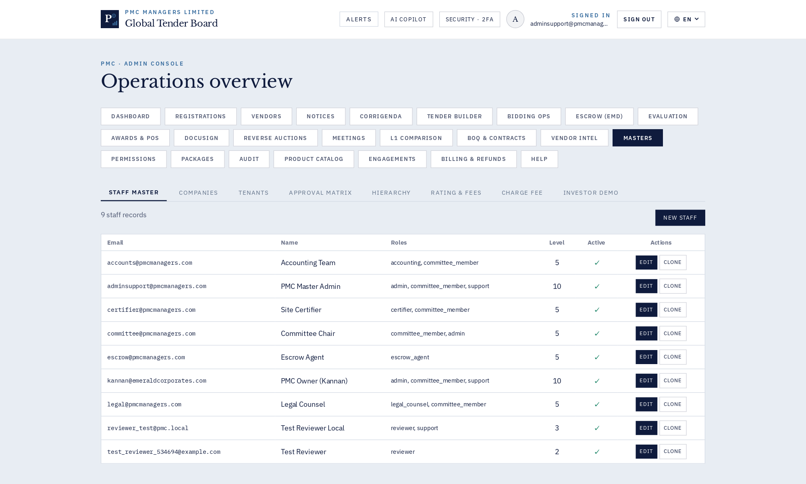

*Admin · Masters — fees, roles, EMD*

#### How to use

This screen exposes every action available for its module. Use the InfoDot (ⓘ) next to each label to see the field-level rules — hover it in-app for the full policy text. All destructive actions confirm before applying and every mutation is written to the immutable audit log.

### 27 · Admin · Roles & permissions

Fine-grained ACL matrix.

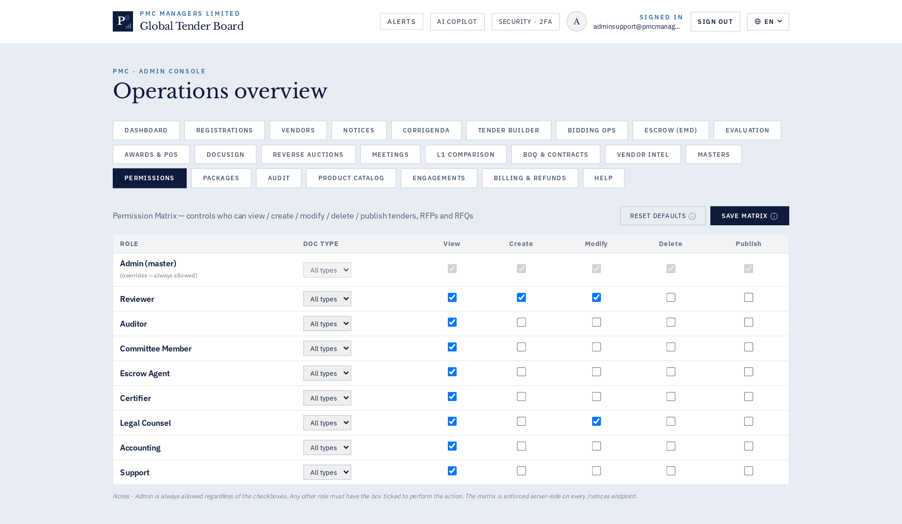

*Admin · Roles & permissions*

#### How to use

This screen exposes every action available for its module. Use the InfoDot (ⓘ) next to each label to see the field-level rules — hover it in-app for the full policy text. All destructive actions confirm before applying and every mutation is written to the immutable audit log.

### 28 · Admin · Work packages

Modular deliverable packages for the KZ programme.

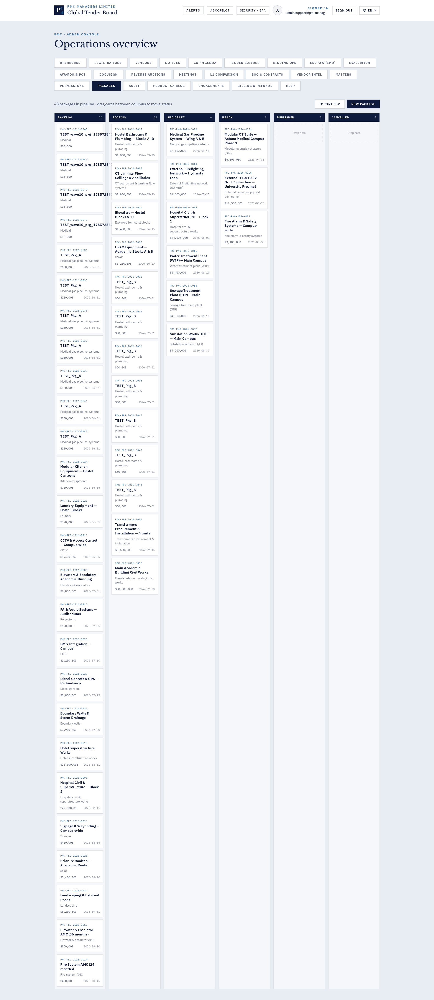

*Admin · Work packages*

#### How to use

This screen exposes every action available for its module. Use the InfoDot (ⓘ) next to each label to see the field-level rules — hover it in-app for the full policy text. All destructive actions confirm before applying and every mutation is written to the immutable audit log.

### 29 · Admin · Audit trail

Immutable action log with entity filters.

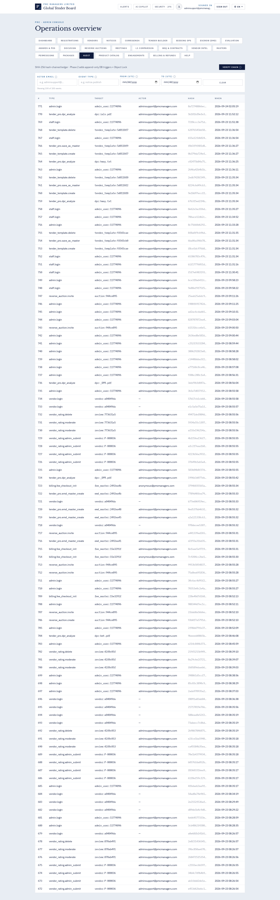

*Admin · Audit trail*

#### How to use

This screen exposes every action available for its module. Use the InfoDot (ⓘ) next to each label to see the field-level rules — hover it in-app for the full policy text. All destructive actions confirm before applying and every mutation is written to the immutable audit log.

### 30 · Admin · Product catalog

UNSPSC-mapped goods catalog.

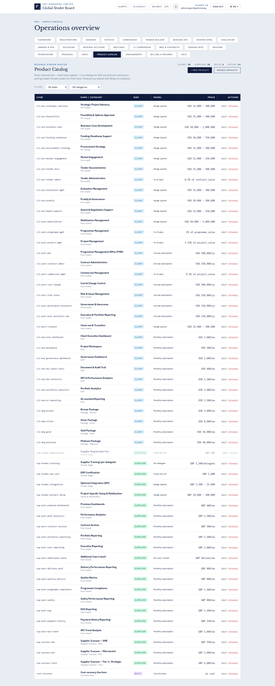

*Admin · Product catalog*

#### How to use

This screen exposes every action available for its module. Use the InfoDot (ⓘ) next to each label to see the field-level rules — hover it in-app for the full policy text. All destructive actions confirm before applying and every mutation is written to the immutable audit log.

### 31 · Admin · Consultant engagements

Retainer engagements, timesheets, invoices.

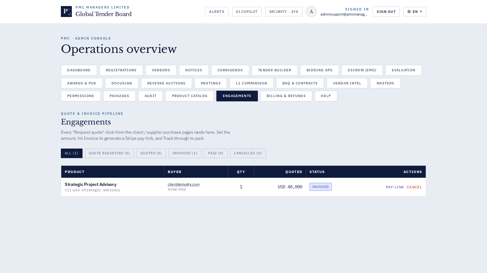

*Admin · Consultant engagements*

#### How to use

This screen exposes every action available for its module. Use the InfoDot (ⓘ) next to each label to see the field-level rules — hover it in-app for the full policy text. All destructive actions confirm before applying and every mutation is written to the immutable audit log.

### 32 · Tender Builder · AI DPR modal (v46g deep-dive)

Country-first DPR ingestion. When the country has no master, admins can borrow one from another country or build a brand-new master. Deep-dive (v46g) discovers 12–30 real chapters from the DPR and drafts each body.

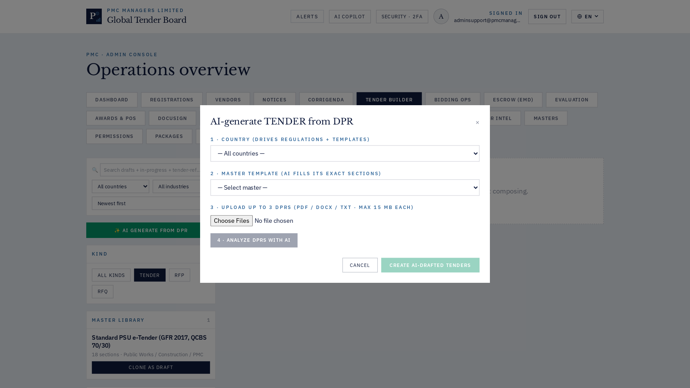

*Tender Builder · AI DPR modal (v46g deep-dive)*

#### How to use

This screen exposes every action available for its module. Use the InfoDot (ⓘ) next to each label to see the field-level rules — hover it in-app for the full policy text. All destructive actions confirm before applying and every mutation is written to the immutable audit log.

### 33 · Tender Builder · No-master options

When the picked country has no saved masters, an amber helper offers two options: (1) borrow a master from another country (all masters listed with country-code prefix), or (2) build a brand-new master from this DPR.

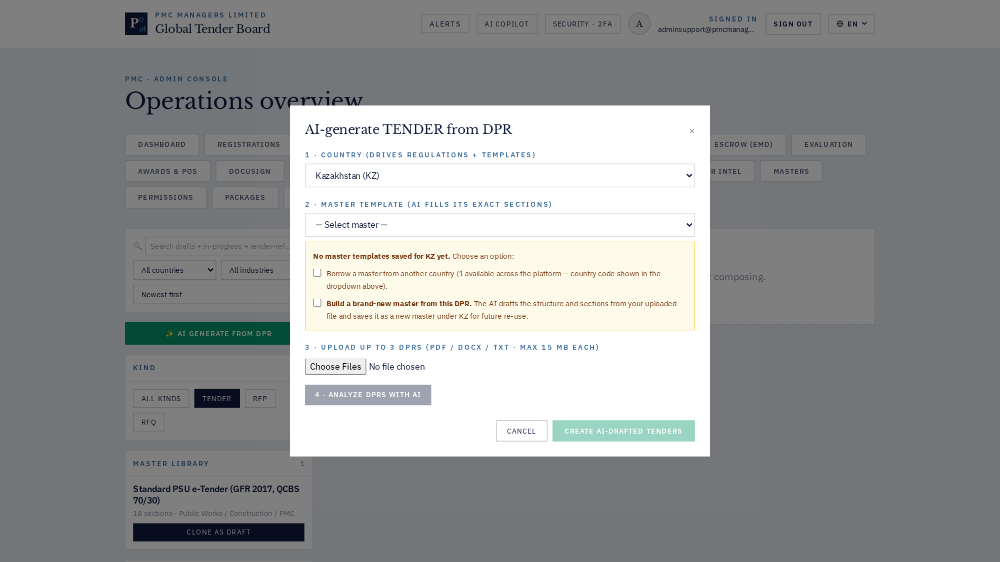

*Tender Builder · No-master options*

#### How to use

This screen exposes every action available for its module. Use the InfoDot (ⓘ) next to each label to see the field-level rules — hover it in-app for the full policy text. All destructive actions confirm before applying and every mutation is written to the immutable audit log.

## 6 · Deep-dive: Tender Builder & AI DPR (v46g)

v46g delivers a two-pass AI ingestion pipeline that turns any Detailed Project Report (DPR) into a structured tender pack:

- **Pass 1** — extracts the header (work title, budget, timeline, evaluation method, EMD) and dynamically discovers 12–30 real chapters from the document (project overview, financials, risk, annexures, …).
- **Pass 2** — drafts each chapter's body in parallel from the most relevant passage of the DPR, using an asyncio semaphore of 6.

On the KMT DPR (1.37 MB PDF, 68 704 chars extracted) the deep-dive discovered **26 sections** — Executive Summary, Market Analysis, Project Investment, Operating Expense Detail, Projected Operational Results, Fund Requirement, Returns & Scenario Analysis, Installation & Commissioning Schedule, Risk Factors & Mitigation, Financial Statements & Models, Legal & Compliance Requirements, Annexures — each with a 1.2–1.9 KB drafted body. End-to-end LLM time ~34 s.

Country-first flow: pick a country → filter masters → if none exist, either borrow one from another country (dropdown shows country-code prefix) or 'Build a brand-new master from this DPR'. The new master is persisted via `POST /api/v1/tender-pro/templates/{id}/save-as-master` with top-level `country` + `industry` so it feeds future runs.

## 7 · Tooltip + error-handling system

The platform ships three complementary UX safeties.

- **InfoDot (ⓘ)** — hover-tooltip component used **166 times** across 20+ admin panels. Every field label with a non-obvious policy has one attached. Source: `frontend/src/components/InfoDot.jsx`.
- **`showApiError` / `formatApiError`** — 67 files consume these helpers. Every server error surfaces as a sonner toast with the exact backend detail (never a bare stacktrace). Source: `frontend/src/lib/api.js`.
- **`ErrorBoundary`** — mounted at the app root; catches any React crash and renders a graceful fallback with a copyable diagnostic id.

## 8 · Troubleshooting playbook

| Symptom | Root cause | Fix |
|---|---|---|
| Landing page shows 0 counters | Stale cached bundle after deploy | Hard-refresh (Cmd-Shift-R on Safari) |
| 'No matching employee account' toast | Preview API URL baked into prod build | Rebuild with `REACT_APP_BACKEND_URL="" yarn build` |
| DPR analyse returns generic 5 sections | Backend still on v46d | Deploy v46g backend zip |
| Login OK but /admin bounces to /login | Cross-site cookie blocked | Ensure frontend uses same-origin `/api` |
| 413 on large DPR | Nginx body limit | v46d ships `.platform/nginx/conf.d/proxy.conf` at 25 MB |
| Login stuck / no network activity | Service worker serving stale bundle | Self-destruct SW shipped in v46d |

## 9 · Glossary

- **DPR** — Detailed Project Report.
- **EMD** — Earnest Money Deposit; refundable bid security.
- **QCBS** — Quality- & Cost-Based Selection (technical 70 / financial 30 default).
- **Corrigendum** — official post-publication amendment to a notice.
- **L1** — lowest financial bid post-technical qualification.
- **BOQ** — Bill of Quantities; itemised deliverable+rate schedule.

